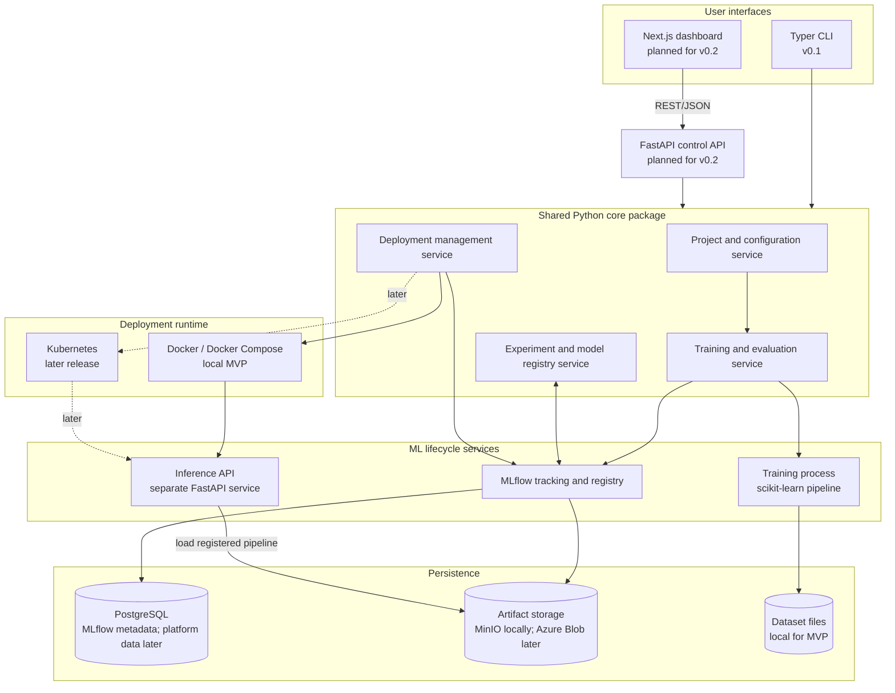

# ModelForge Architecture

## Status and scope

This document describes the intended architecture based on the [product specification](product-specification.md). The repository is in its planning and foundation stage; the components below are architectural plans, not claims that those services have been implemented.

The design has two checkpoints:

- **v0.1 local MVP:** Python CLI and shared core services manage a local ML lifecycle. MLflow tracks experiments and model versions; Docker Compose can provide persistent local services.
- **Later full-stack releases:** a FastAPI control API and Next.js dashboard use the same core services. Kubernetes, monitoring, and Azure are introduced only after the local workflow works.

## Logical architecture

The diagram shows the target logical shape. At v0.1, the CLI calls the shared Python core directly; the web app, control API, Kubernetes, and Azure storage are future components.

## Component responsibilities

| Component | Responsibility | Release |
| --- | --- | --- |
| Typer CLI | Initializes/configures projects and invokes core lifecycle operations. It contains command parsing and user-facing output, not a second copy of business rules. | v0.1 |
| Shared Python core | Owns configuration, project operations, training/evaluation orchestration, experiment/model operations, and deployment coordination. Reused by CLI and API. | v0.1 onward |
| Training pipeline | Validates data, fits preprocessing only on training data, trains supported classifiers, evaluates on held-out data, and produces a serialized preprocessing/model pipeline. | v0.1 |
| MLflow | Records runs, parameters, metrics, artifacts, and registered model versions. | v0.1 |
| PostgreSQL | Stores MLflow metadata locally; later can also store ModelForge API entities through SQLAlchemy and Alembic. Keep the ownership of MLflow tables and ModelForge tables distinct. | v0.1 / later |
| Artifact storage | Holds model and run artifacts. Use MinIO for local object storage when configured; use Azure Blob Storage for the cloud release. | v0.1 / later |
| Inference API | Loads a selected registered pipeline, validates prediction requests, returns predictions, and exposes health information. Runs separately from the control API. | v0.1 |
| Docker / Docker Compose | Packages inference and starts the local services needed for reproducible development. | v0.1 |
| FastAPI control API | Exposes project, run, model, deployment, and prediction operations as REST/JSON. Delegates to shared core services. | v0.2 |
| Next.js dashboard | Presents real data from the control API for projects, experiments, models, deployments, and predictions. | v0.2 |
| Kubernetes | Runs and manages inference deployments with health probes, resources, and scaling controls. | Later release |
| Prometheus / Grafana | Collects and displays operational metrics; model/data monitoring is added as its own verified capability. | Later release |
| Terraform / Azure | Provisions cloud infrastructure and storage for a hosted deployment. | v1.0 target |

## Main boundaries

1. **Frontend to backend:** the dashboard communicates only with the FastAPI control API using documented JSON contracts. It never connects directly to PostgreSQL, MLflow, object storage, or Kubernetes.
2. **CLI and API to core:** both entry points call shared Python services. CLI and HTTP layers handle input/output and transport concerns; lifecycle rules live in the core.
3. **Control plane to inference:** the control API/core manages deployments and model selection. The inference service handles prediction and health requests. They are separate processes and can be scaled or restarted independently.
4. **Training to inference:** both use the same saved preprocessing/model pipeline. The serving service loads a registered model version and does not refit preprocessing.
5. **Metadata to artifacts:** MLflow metadata and large artifacts have separate persistence roles. PostgreSQL stores run/registry metadata; object storage stores artifacts.
6. **Local to cloud runtime:** Docker Compose supports the local MVP. Kubernetes and Azure are later runtime choices and must not be required to complete v0.1.

## Key data flow

### Train and register

1. A user supplies a project configuration and dataset path through the CLI (and later through the API).
2. The core validates configuration and dataset schema.
3. The training pipeline splits the data, fits preprocessing and candidate models on training data, then evaluates on held-out data.
4. The core records parameters, metrics, dataset fingerprint, and artifacts in MLflow.
5. A user selects a successful run and registers its serialized pipeline as a model version.

### Deploy and predict

1. The user selects a registered model version for deployment.
2. The deployment service starts an inference container with that model version and its configuration.
3. The inference service loads the saved pipeline and exposes health and prediction endpoints.
4. A prediction request is validated, passed through the saved preprocessing/model pipeline, and returned as JSON.
5. Deployment and inference outcomes are recorded or exposed for inspection; richer monitoring is added in later releases.

## Interfaces and contracts

- **Configuration:** YAML validated by Pydantic. It identifies the project, dataset, target, split/seed, model settings, and tracking configuration. Exact fields are defined in MF-003 before implementation.
- **Core service interfaces:** typed Python inputs and results for project configuration, training runs, model versions, deployment requests, and prediction metadata. The CLI and API should call these interfaces rather than MLflow directly for lifecycle operations.
- **Control API:** REST/JSON with Pydantic request/response schemas and generated OpenAPI documentation. Define exact routes and error shapes in MF-003/API contract work.
- **Inference API:** JSON request/response schema tied to the selected model's expected feature names and types; invalid payloads return actionable client errors.
- **Persistence:** Alembic migrations version ModelForge-owned relational schema when it is introduced. MLflow owns its tracking/registry schema.

## Initial deployment topology

For v0.1, keep the topology small:

- The CLI and Python core run in the developer environment or a local application container.
- The training process runs locally or in a container and logs to MLflow.
- Docker Compose starts MLflow, PostgreSQL, MinIO, and the inference container as required by the selected local setup.
- Dataset files remain local and are referenced through configuration; document dataset source, license, and fingerprint.

The exact Compose services and startup commands belong in the deployment documentation when implemented. Persistent background workers such as Redis and RQ are deferred until a real long-running API operation needs asynchronous execution.

## Decisions and deferred questions

- Start with a modular Python application and separate inference process; avoid splitting every core capability into a microservice.
- Use MLflow for experiment tracking and model registry rather than implementing a competing registry.
- Keep the CLI useful before the web application exists.
- Define exact configuration keys, API resources, and core data structures in MF-003.
- Revisit whether the control API needs a durable job queue after training/deployment operations are implemented and measured.
- Confirm model artifact access and deployment credentials for local and Azure environments before cloud implementation.
